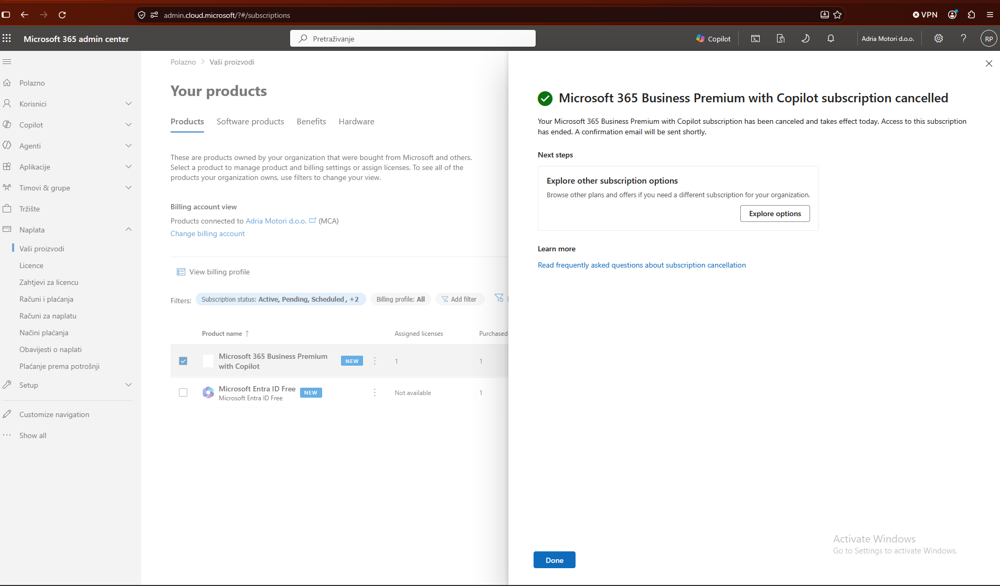

# L00 Tenant setup

Request: "You start on Monday. Here is an empty tenant and an export from HR. Set it up like a security person, not like an installation wizard."

Closed on 15 October 2026. CISSP domains 5 (identity and access management) and 1 (security and risk management).

## What was built

| Account or object | Purpose | Roles and licence |
| --- | --- | --- |
| `adm-romano` | Administration only, never used for mail or documents | Global Administrator, no licence |
| `bg-01` | Break-glass account for emergency access | Global Administrator, no licence |
| `romano.pavan` | My daily account | Business Premium through the licence group, no admin role |
| `dario.novak` | My manager | Global Reader and Billing Administrator |
| 12 other employees | Created from the HR export | Business Premium through the licence group |
| `GRP-Odjel-<department>` (8 groups) | One group per department, dynamic on `user.department` | None |
| `GRP-Licenca-BusinessPremium` | Licence group, dynamic on `companyName` and `accountEnabled` | Business Premium |

Security defaults stay on until L02 replaces them with Conditional Access. The data location of the tenant is in the EU.

The HR export has 15 rows. One person left on 30 September 2026 and did not get an account: the script skips anyone whose leaving date is in the past.

## How the script works

[`scripts/L00-kreiraj-korisnike.ps1`](../scripts/L00-kreiraj-korisnike.ps1) has two modes.

Without `-Izvrsi` it only reads the CSV, validates it and prints the plan. It stops on an unknown office location (usage location is required for licensing) and on duplicate user names, and it connects to nothing.

With `-Izvrsi` it:

1. asks you to type DA, in capitals, and stops without changes on any other answer,
1. checks that the Microsoft Graph modules are installed,
2. signs in with five delegated scopes and stops if the signed-in account belongs to a different tenant,
3. creates the active employees, skipping any that already exist, with a 20-character temporary password that must be changed at first sign-in,
4. sets each user's manager from the HR export,
5. creates the department groups and the licence group as dynamic security groups, skipping existing ones,
6. assigns Business Premium to the licence group,
7. gives Dario the Global Reader and Billing Administrator roles if he does not have them yet,
8. writes the temporary passwords to a file in the home folder, never to the screen or the repository.

Because existing users, groups and role assignments are skipped, the script can be run again safely. Croatian letters are transliterated by character code, so the result does not depend on how the CSV file is encoded.

## Decisions

D-001 to D-004 in [decisions.md](decisions.md): a separate admin account without a licence, a break-glass account without a hardware key for now, licensing through a dynamic group, and no billing changes during a trial.

## What went wrong

Two trial subscriptions were lost before the third one stuck.

The first trial had a single licence. I used "Cancel subscription" to stop it from renewing into a paid plan, and it ended the same day, with Reactivate greyed out.

The second trial had 25 licences. On a Microsoft Customer Agreement trial, "Edit recurring billing" followed by "Cancel on expiration" also cancels immediately, which the label does not suggest.

The third trial has 25 licences and is set to continue with one paid licence on 14 November 2026. The rule now is: during a trial, billing settings are not touched. The licence decision is made in the fourth week, and the agreement allows cancellation with a refund within seven days if needed.

## Open items

- Two FIDO2 security keys, one for `bg-01` and one for `adm-romano`. Until then the break-glass account has no phishing-resistant sign-in method, which is an accepted risk. Carried over to L02 (decision D-010).
- Done: the admin account's display name is now "Romano Pavan (admin)", so audit entries show which account made a change.

## CISSP concepts

Identity lifecycle (joiner, mover, leaver), least privilege, separation of duties, privileged account management, attribute-based access control.
