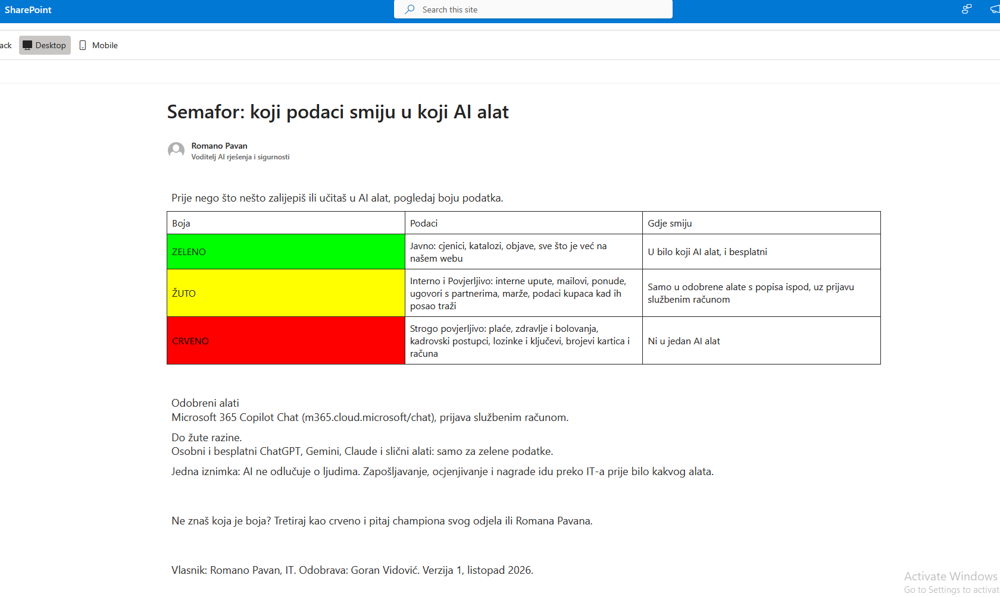
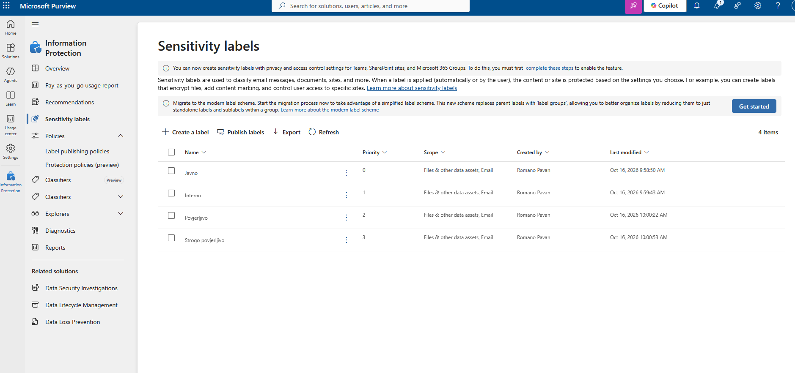
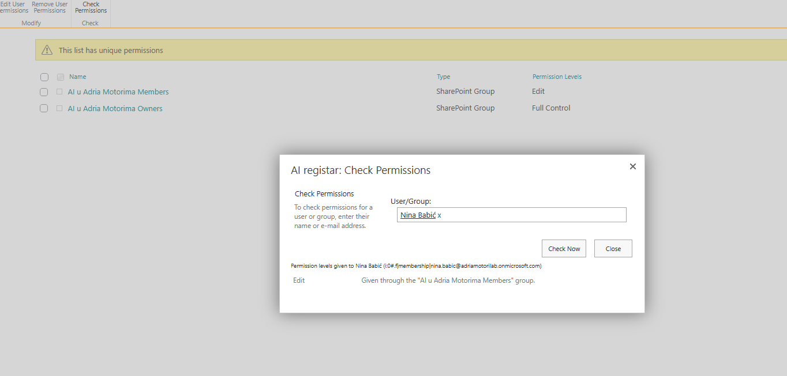
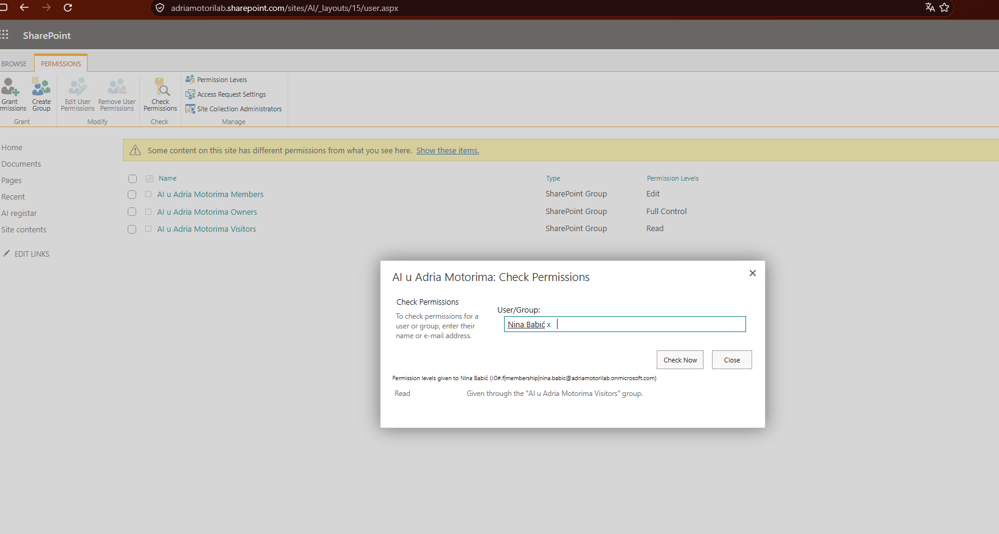
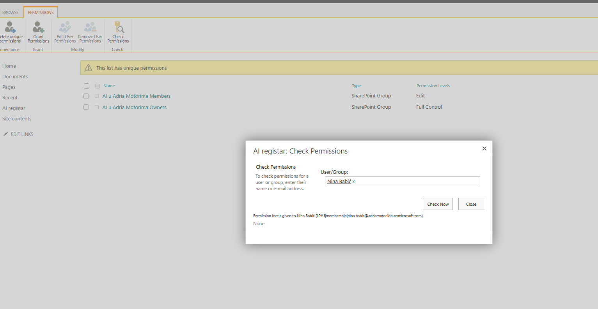
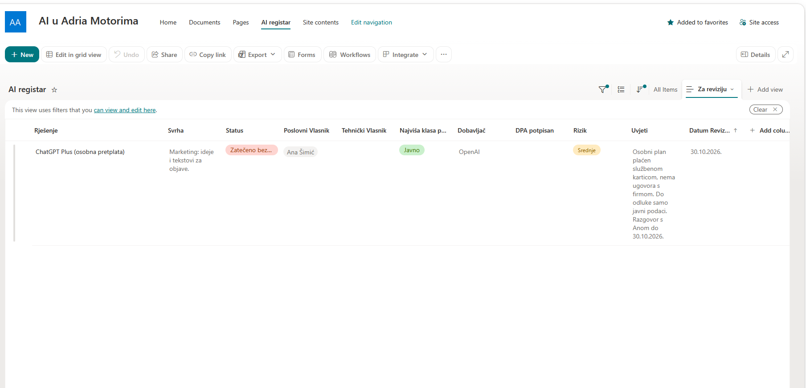

# L01 AI register and data traffic light

Request from Dario, my manager: "From Monday the AI champions start sending AI ideas. Before that I need a place where every AI tool we use or plan to use is recorded, and a clear rule on which data may go into which tool. Legal is also asking about some labels on documents, something in Purview. Keep it simple, people here don't read policies."

Closed on 16 October 2026. CISSP domains 2 (asset security) and 1 (security and risk management).

## Questions asked before building

| Question | Answer from the requester | What it changed |
| --- | --- | --- |
| Who owns the register and who may edit it? | I own it; champions and managers should see it | Ownership. Visibility was challenged, see below |
| Is the register the same as the list of ideas? | No, ideas go to a backlog | Two lists, so the register does not fill up with wishes |
| Only paid tools, or also what people use on their own? | Everything we know is in use | A status column that includes "found without approval" |
| What already exists? | A 2019 data protection policy nobody reads; Copilot Chat in Edge; a personal ChatGPT Plus subscription paid with a company card | The register starts with two entries |
| Where does it live? | Nothing exists yet | A new SharePoint communication site |
| Legal wants four labels, people want three colours. How do they map? | Four levels for the group, three colours for people | The mapping below |
| Real examples per level? | Price lists public, procedures internal, partner contracts and margins confidential, salaries strictly confidential | Examples on the policy page |
| Who approves? | IT reviews the register, the CEO signs the policy, group legal approves label names | The policy page is a draft until the CEO approves it |
| Should the labels reach users now? | No, legal only wants to see them | Labels created, not published |
| How is risk rated and how often reviewed? | Low, medium, high; once a year or when the supplier or terms change | A choice column and a mandatory review date |

I disagreed with one answer. The register holds risk assessments, supplier weaknesses and the name of a colleague using an unapproved tool, so only IT reads it. Everyone else gets the policy page with the list of approved tools. Dario accepted, and champions get read access later through their own group.

## The register

A list named "AI registar" on the communication site "AI u Adria Motorima" (`/sites/AI`). Every column was created with an ASCII name first and renamed afterwards, because SharePoint fixes the internal name at creation and diacritics turn into encoded names that break flows and scripts later.

| Column | Internal name | Type | Required | Why |
| --- | --- | --- | --- | --- |
| Rješenje | Title | Single line of text | Yes | The tool or solution |
| Svrha | Svrha | Multiple lines of text | Yes | What it does and for which work |
| Status | Status | Choice: Odobreno, U procjeni, Zabranjeno, Zatečeno bez odobrenja | Yes | Approved, under review, banned, found without approval |
| Poslovni vlasnik | PoslovniVlasnik | Person | Yes | The data owner, accountable for the use |
| Tehnički vlasnik | TehnickiVlasnik | Person | No | The custodian; empty means IT has no control over the tool |
| Najviša klasa podataka | KlasaPodataka | Choice: Javno, Interno, Povjerljivo, Strogo povjerljivo | Yes | The most sensitive data the tool may process |
| Dobavljač | Dobavljac | Single line of text | Yes | Supplier |
| DPA potpisan | DPA | Yes/No, default No | No | Whether a data processing agreement exists; no until someone shows it |
| Rizik | Rizik | Choice: Nisko, Srednje, Visoko | Yes | Low, medium, high |
| Uvjeti | Uvjeti | Multiple lines of text | No | Conditions of approval |
| Datum revizije | DatumRevizije | Date | Yes | Next review |

Person columns instead of text mean that an owner who leaves the company shows up in the register. The column definitions and the two starting entries are also in [`register/`](../register).

### Permissions

| Scope | Who | Level |
| --- | --- | --- |
| Site | Owners: me | Full control |
| Site | Members: IT (Dario) | Edit |
| Site | Visitors: `GRP-Svi-Zaposlenici` | Read |
| AI register list | Unique permissions, Visitors removed | Owners and Members only |

`GRP-Svi-Zaposlenici` is a new dynamic security group with the same rule as the licence group. I did not reuse the licence group: licence groups change when licensing changes, and access should not change with them. I also avoided the built-in "Everyone except external users", the usual source of oversharing.

### Review view

A view named "Za reviziju" shows entries whose review date is within 30 days (`Datum revizije` less than or equal to `[Today]+30`). It only works properly after the site's regional settings are set to the Zagreb time zone, because `[Today]` is calculated in the site's time zone, and to the Croatian locale, so dates are entered day first.

### Starting entries

| Solution | Status | Highest data class | Supplier | DPA | Risk |
| --- | --- | --- | --- | --- | --- |
| Microsoft 365 Copilot Chat | Approved | Povjerljivo | Microsoft | Yes | Low |
| ChatGPT Plus, personal subscription | Found without approval | Javno | OpenAI | No | Medium |

## The data traffic light

The traffic light answers one question for a person about to paste something into an AI tool: which colour is this data, and which tool may take it.

| Colour | Sensitivity labels | Where the data may go |
| --- | --- | --- |
| Green | Javno (public) | Any AI tool, including free ones |
| Yellow | Interno (internal), Povjerljivo (confidential) | Only approved tools from the register, signed in with the work account, up to the class recorded for that tool |
| Red | Strogo povjerljivo (strictly confidential) | No AI tool, except a solution approved in the register for exactly that data |

Internal and confidential data share yellow because they differ in who inside the company may see them, not in which tool may take them. That difference is handled by permissions and labels. Anything a person cannot classify is treated as red.

A policy is approved by management, not by IT, so the page stays a draft until the CEO approves it. His review asked for one change: an exception in the red row, so the policy does not need rewriting when a tool is one day approved for salary data. After that the page is published as the site's home page. The approved text, in Croatian and in English, is in [`policy/data-traffic-light.md`](../policy/data-traffic-light.md).

The draft before the review:

## Sensitivity labels

Four labels in Microsoft Purview, scoped to files and email, without encryption or content marking, and not published in any label policy. The full set is in [`policy/sensitivity-labels.md`](../policy/sensitivity-labels.md).

Encryption waits for a later ticket because it changes what Copilot can read and breaks sharing outside the company. Labels are created in order of sensitivity, so Strogo povjerljivo has the highest priority.

## Copilot data residency review

Before naming Copilot Chat as the approved tool for yellow data, I checked the Copilot settings in the admin center. Three defaults let data leave the EU Data Boundary. They were turned off and recorded in the register entry. See [the finding](../findings/copilot-eu-data-boundary-defaults.md).

## Verification

Check Permissions on a test user (Nina, sales) was the acceptance test.

The first run showed Edit on the register, inherited from Site Members, because the all-staff group had been added there by mistake:

After moving the group to Site Visitors, Nina has Read on the site and no access to the register:

The review view shows only the entry due within 30 days:

## Mistakes and fixes

1. The all-staff group was added to Site Members instead of Site Visitors. Found by the permission test, fixed before the site was announced.
2. The Copilot entry got today's date as its review date, because the site used the US date format. Fixed by setting the site's locale and time zone, then correcting the date.
3. In Purview I clicked "Turn on now" for sensitivity labels in SharePoint and OneDrive by accident. It enables label processing for Office files in SharePoint and OneDrive (the `EnableAIPIntegration` tenant setting). With no label published, users see nothing to apply. I kept it, because a later ticket needs it, and logged it as an unplanned change (D-009).

## CISSP concepts

Classification is decided by the data owner and carried out by the custodian. Labeling is metadata for machines; marking is what people see on the document. Need-to-know decided who reads the register. The accidental setting and the vendor defaults both went through change management.
