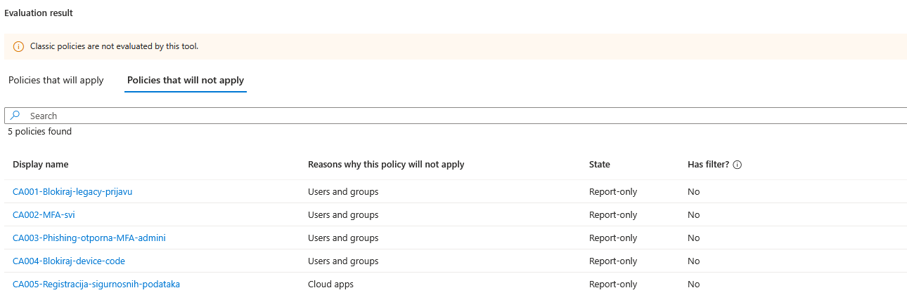
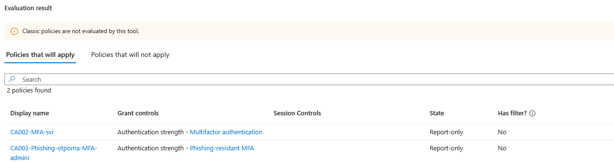
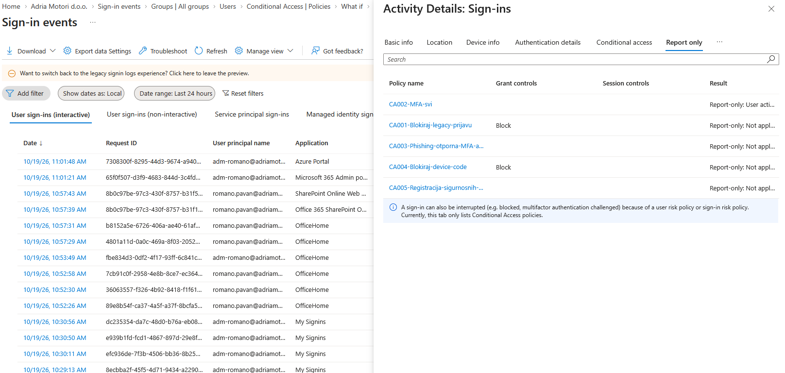
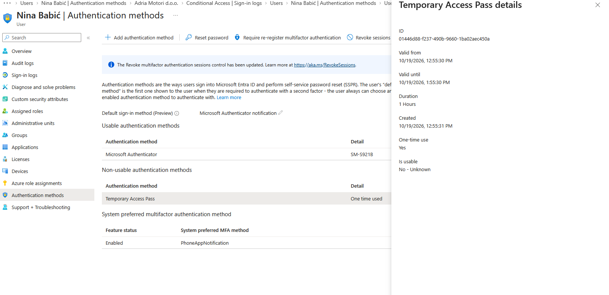
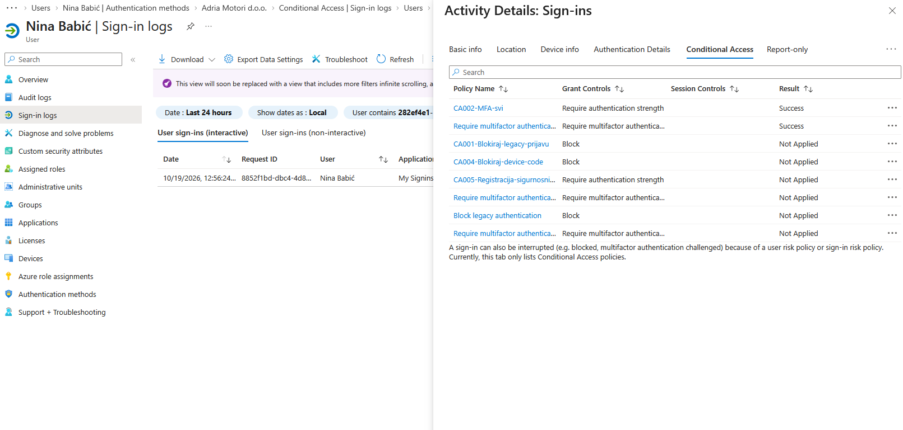

# L02 Conditional Access in place of security defaults

Request from Dario, my manager: "Microsoft says organisations with Entra ID P1 probably should not stay on security defaults. Move us to Conditional Access, and nobody gets locked out."

Closed on 19 October 2026 with one policy left in report-only (CA003, see [open items](#open-items)). CISSP domains 5 (identity and access management) and 1 (security and risk management).

## What security defaults did and what replaced them

Security defaults are one switch for the whole tenant, on or off. Conditional Access needs Entra ID P1, which Business Premium includes, and security defaults must be turned off when Conditional Access replaces them.

| Security defaults | Replaced by |
| --- | --- |
| Every user registers for MFA | CA002 makes a user without a method register at first sign-in; CA005 protects the registration itself |
| MFA for administrators at every sign-in | CA002 now, CA003 when hardware keys arrive |
| MFA for other users when Microsoft judges it necessary | CA002, stricter: whenever the session has no MFA |
| Block legacy authentication protocols | CA001 |
| Block device code flow | CA004 |
| MFA for the Azure portal, Azure PowerShell and Azure CLI | CA002 targets all resources; Microsoft's mandatory MFA for admin portals applies regardless |

One known difference: security defaults asked administrators for MFA at every sign-in, while CA002 accepts MFA already present in the session. Until CA003 is on, administrators are slightly less covered than before.

## Policies

| Policy | Users | Excluded | Target | Control | State | Why |
| --- | --- | --- | --- | --- | --- | --- |
| CA001-Blokiraj-legacy-prijavu | All users | `GRP-Hitni-pristup` | All resources; client apps Exchange ActiveSync and Other clients | Block | On | Legacy protocols cannot do MFA, so a password alone gets in |
| CA002-MFA-svi | All users | `GRP-Hitni-pristup`, `GRP-CA-Izuzeci` | All resources | Authentication strength: Multifactor authentication | On | The baseline for everyone |
| CA003-Phishing-otporna-MFA-admini | 11 directory roles, listed below | `GRP-Hitni-pristup` | All resources | Authentication strength: Phishing-resistant MFA | Report-only | Push approvals and one-time codes can be phished, and admin accounts are the ones worth phishing |
| CA004-Blokiraj-device-code | All users | `GRP-Hitni-pristup` | Authentication flow: device code flow | Block | On | In device code phishing the victim completes MFA on Microsoft's real page and the attacker receives the tokens |
| CA005-Registracija-sigurnosnih-podataka | All users | `GRP-Hitni-pristup` | User action: register security information | Authentication strength: Multifactor authentication | On | Someone holding only a password cannot register their own MFA method |

CA003 covers Global Administrator, Privileged Role Administrator, Privileged Authentication Administrator, Security Administrator, Conditional Access Administrator, Authentication Administrator, User Administrator, Exchange Administrator, SharePoint Administrator, Billing Administrator and Global Reader. Dario holds Global Reader and Billing Administrator, so he falls under it too.

The three MFA policies use an authentication strength rather than the plain "Require multifactor authentication" grant. Tightening a policy later then means choosing a stronger strength, not rebuilding the policy.

## Supporting objects

| Object | Setting | Why |
| --- | --- | --- |
| `GRP-Hitni-pristup` | Role-assignable security group, assigned membership, member `bg-01` | Excluded from every policy. Only Global Administrators, Privileged Role Administrators and the group's owners can change the membership of a role-assignable group, so a User Administrator cannot add themselves to the exclusion |
| `GRP-CA-Izuzeci` | Role-assignable, assigned membership; member Marko Jurišić, reason and expiry date (19 November 2026) in the description | Temporary exceptions from CA002, each with a reason and an end date |
| Passkey (FIDO2) method | Device-bound passkeys only, restricted to the Microsoft Authenticator AAGUIDs | Phishing-resistant admin sign-in without a hardware key |
| Temporary Access Pass | Target `GRP-Svi-Zaposlenici`; lifetime 1 to 8 hours, default 1 hour; one-time use; 8 characters | A new employee's first MFA registration |

## Rollout

1. All five policies were created in report-only between 10:37 and 10:45.
2. What If showed the emergency account outside every policy and the admin account under CA002 and CA003. CA005 does not match `bg-01` for a different reason: it targets a user action, not an app.

   

   

3. Report-only results on real sign-ins showed the impact. On a non-admin sign-in (CA003 not applied), CA002 reported "User action required": the sign-in had passed with a password alone, because security defaults ask ordinary users for MFA only when Microsoft judges it necessary. Once CA002 is on, people see MFA prompts where they did not before. That is the change to announce to staff.

   

4. CA001 and CA004 were not applied on any sign-in checked, so nobody depended on legacy protocols or device code.
5. Security defaults were turned off at 12:43:56, with the reason "My organization is using Conditional Access".
6. CA001, CA004, CA002 and CA005 were switched on between 12:45:22 and 12:46:02, in that order. Policies that would affect nobody went first, the one users feel came next, and CA005 went last because the onboarding test depends on it. CA003 stays in report-only.

Eight seconds after security defaults went off, Microsoft created four policies of its own, already on. See [the finding](../findings/security-defaults-upgrade-policies.md) and decision D-011.

## Onboarding a new employee with a Temporary Access Pass

An employee with no MFA method cannot satisfy CA005, so they cannot register one with a password alone. IT checks who the person is and issues a Temporary Access Pass (TAP): one hour, one use. The employee signs in with it at Security info and registers Microsoft Authenticator.

Tested with Nina Babić. The pass was valid from 12:55:30 to 13:55:30 and is now marked "One time used". Her sign-in at 12:56:24 satisfied CA002, and she registered Microsoft Authenticator.

The same screenshot shows Microsoft's four policies applied alongside mine, which is how they were found.

## Verification

| Check | Expected | Result |
| --- | --- | --- |
| What If, `bg-01` | No policy applies | Passed |
| What If, `adm-romano` | CA002 and CA003 apply | Passed |
| Report-only, non-admin sign-in | CA002 would require MFA | Passed: User action required |
| New employee with a TAP | The TAP satisfies CA002 and the employee registers Authenticator | Passed |
| Device code sign-in as `romano.pavan` | Blocked by CA004 | Not verified: the flow reached the consent prompt and the PowerShell session timed out after 120 seconds |
| Password-only sign-in by a user without MFA | CA005 blocks registration | Not run |
| `bg-01` signs in after the switch | No policy applies | Not run live, What If only |
| Passkey sign-in as `adm-romano` | CA003 satisfied | Failed, see open items |

The tests not run are the ones a production rollout needs before the change window closes. This is a lab tenant with fictional users, so they were skipped on purpose.

## Open items

- Two FIDO2 security keys, one for `bg-01` and one for `adm-romano`. CA003 goes on once `adm-romano` has a working phishing-resistant method. Dario needs one too, or loses his two roles.
- The passkey in Microsoft Authenticator is registered for `adm-romano` (device-bound, AAGUID of Authenticator for Android), but sign-in with it fails both from the PC by QR code and on the phone itself. Bluetooth is ruled out, since the same-device sign-in does not use it. Next suspect: Authenticator not enabled as a passkey provider in the phone's settings.
- Marko Jurišić's exception from CA002 expires on 19 November 2026.
- Until the keys arrive, `adm-romano`, `bg-01` and my daily account all rely on Microsoft Authenticator on one phone. Accepted risk, decision D-010.

## Mistakes and fixes

1. Turning off security defaults created four Microsoft policies, already on and overlapping mine. They were found in the sign-in log of the onboarding test, not on the page where the change was made. Turned off, decision D-011.
2. The emergency account had no MFA method until the Azure portal's mandatory MFA forced one during testing, and it was registered on the same phone as the admin account. Accepted until the keys arrive, decision D-010.

## CISSP concepts

Conditional Access is attribute-based access control: the policy engine evaluates attributes of the user, role, app, client and authentication flow, and Entra enforces the result. Every policy that matches a sign-in applies, and a block beats everything else, so an exclusion is real only when it appears in every policy that matches.

Report-only and What If are impact analysis inside change management. The emergency account trades a little security for availability, which is why it is excluded, monitored and tested.

A Temporary Access Pass turns identity proofing into a credential that is time-limited, single-use and issued after the person has been verified. Phishing-resistant authentication (FIDO2) binds the credential to the site's origin, which push approvals and one-time codes do not do.
