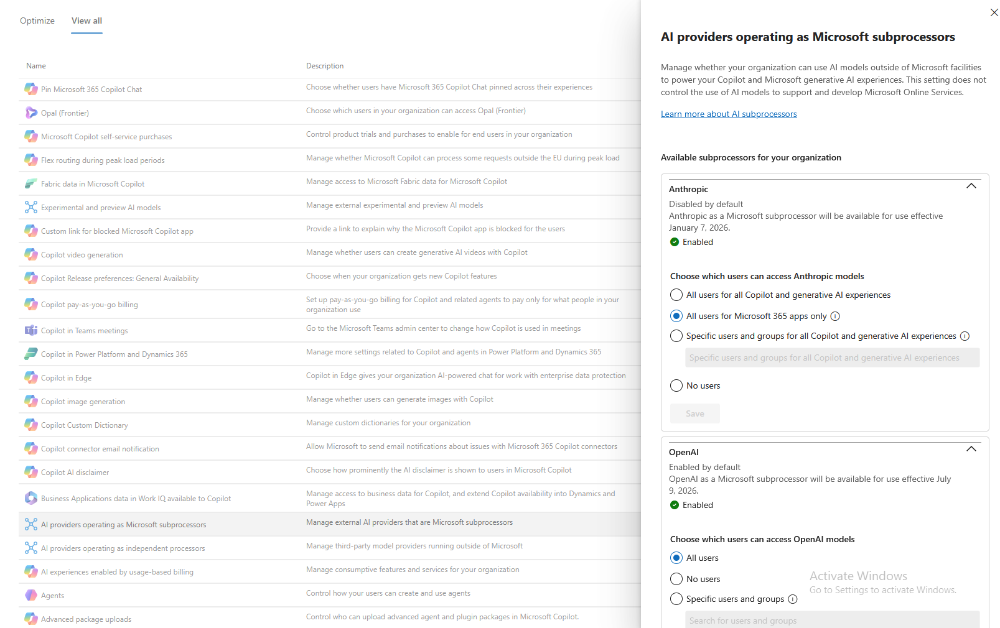

# New EU tenants: Copilot defaults that weaken the EU Data Boundary

Checked on 16 October 2026 in a Microsoft 365 Business Premium tenant created in October 2026, with its data location in the EU.

Three Copilot settings allow processing outside the EU Data Boundary by default in a tenant this new. All three are covered by the Microsoft Data Protection Addendum (DPA), so none of them is a GDPR breach in itself. They do break the assumption behind my data rule for AI tools: that data put into Copilot Chat stays with Microsoft, inside the EU, under the same terms as mail and files.

## What I found and changed

All three settings are in the Microsoft 365 admin center under Copilot, Settings, View all.

| Setting | State found | What it allows | Changed to |
| --- | --- | --- | --- |
| Flex routing during peak load periods | On by default for EU tenants created after 25 March 2026 ([Microsoft Learn](https://learn.microsoft.com/en-us/microsoft-365/copilot/copilot-flex-routing)); state before the change not captured | Model inference in the United States, Canada or Australia during peak demand, and storage of limited pseudonymised data outside the EU Data Boundary | Do not allow flex routing |
| AI providers operating as Microsoft subprocessors: Anthropic | Enabled, "All users for Microsoft 365 apps only" | Anthropic models in Copilot, under the Microsoft DPA but excluded from the EU Data Boundary ([Microsoft Learn](https://learn.microsoft.com/en-us/microsoft-365/copilot/connect-to-ai-subprocessor)) | No users |
| AI providers operating as Microsoft subprocessors: OpenAI | Enabled, "All users" | OpenAI models running on OpenAI's infrastructure, inside the EU Data Boundary with some exceptions and excluded from in-country processing commitments ([Topedia](https://blog-en.topedia.com/2026/07/openai-as-a-subprocessor-for-microsoft-365-copilot-and-copilot-studio-will-be-enabled-on-24-july-2026/)) | No users |
| AI providers operating as independent processors: Mistral AI, Anthropic Models with Data Retention | Off | Providers that keep data under their own terms, outside the Microsoft DPA | Verified off, unchanged |

One gap is not a setting on this page. When Copilot searches the web, it sends a few words derived from the prompt to Bing. For those queries Microsoft acts as an independent controller, outside the DPA and the EU Data Boundary ([Microsoft Learn](https://learn.microsoft.com/en-us/copilot/microsoft-365/enterprise-data-protection)). The register entry for Copilot Chat says so.

## Why the defaults were turned off rather than accepted

Turning them off costs almost nothing in this tenant. There are no Microsoft 365 Copilot licences, Copilot Chat runs on models hosted by Microsoft, and the price is slower answers at peak times. Accepting them would mean lowering the highest data class approved for Copilot Chat, which matters more to the people using it.

The rule I applied: the technical owner may tighten a setting immediately and records it in the AI register; loosening a setting goes through approval. A security setting then never waits for a meeting.

## Keeping it that way

Microsoft changes these defaults through Message center, so it is set to send a weekly email digest for Microsoft 365 Copilot. The settings are rechecked whenever the Copilot register entry is reviewed.

## Sources

- [Copilot flex routing](https://learn.microsoft.com/en-us/microsoft-365/copilot/copilot-flex-routing), Microsoft Learn
- [Anthropic models in Microsoft Online Services](https://learn.microsoft.com/en-us/microsoft-365/copilot/connect-to-ai-subprocessor), Microsoft Learn
- [OpenAI as a subprocessor for Microsoft 365 Copilot and Copilot Studio will be enabled on 24 July 2026](https://blog-en.topedia.com/2026/07/openai-as-a-subprocessor-for-microsoft-365-copilot-and-copilot-studio-will-be-enabled-on-24-july-2026/), Topedia
- [Enterprise data protection in Microsoft Copilot](https://learn.microsoft.com/en-us/copilot/microsoft-365/enterprise-data-protection), Microsoft Learn
