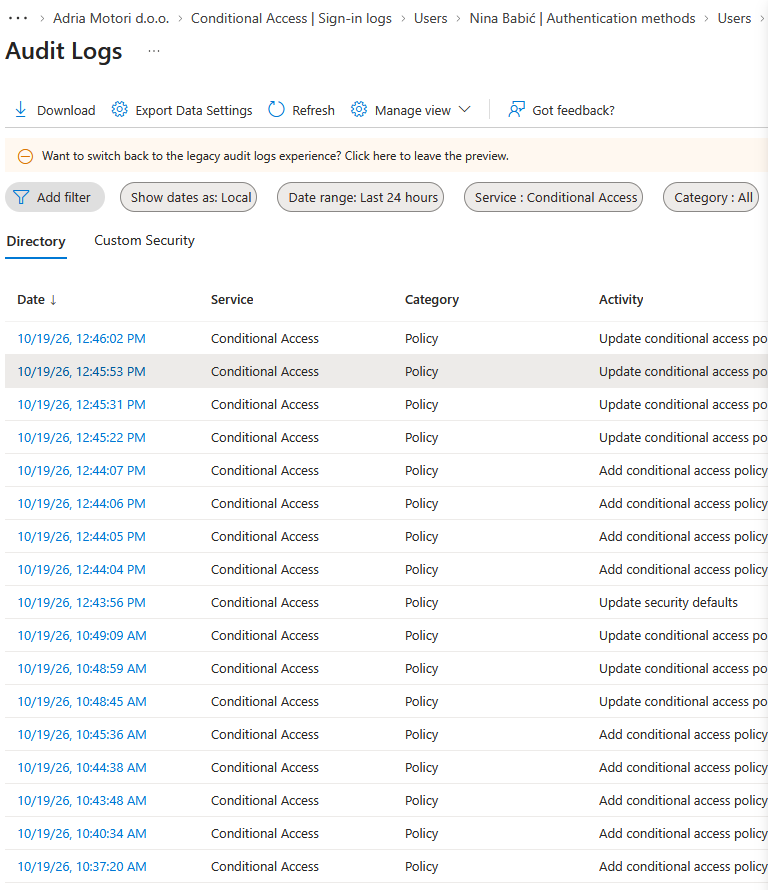
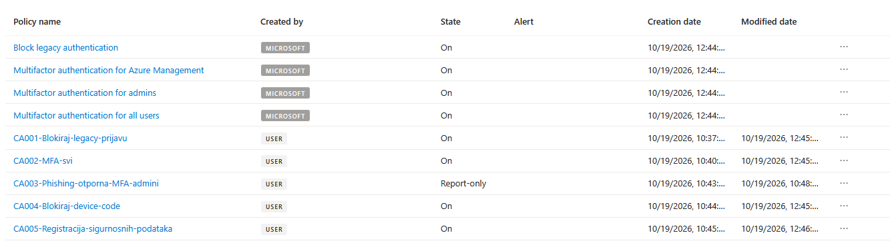

# Turning off security defaults creates four Microsoft policies, already on

Checked on 19 October 2026 in a Microsoft 365 Business Premium tenant (Entra ID P1) created in October 2026.

When I turned security defaults off, Microsoft created four Conditional Access policies within eight seconds. They were on from the start, not in report-only, and the policy list shows Microsoft in the "Created by" column.

| Time (local) | Audit log activity | What happened |
| --- | --- | --- |
| 12:43:56 | Update security defaults | I turned security defaults off |
| 12:44:04 to 12:44:07 | Add conditional access policy, four times | Microsoft created Block legacy authentication, Multifactor authentication for Azure Management, Multifactor authentication for admins and Multifactor authentication for all users |
| 12:45:22 to 12:46:02 | Update conditional access policy, four times | I switched my own CA001, CA004, CA002 and CA005 on |

## Why it matters

Microsoft Learn lists these four as policies "available for when you upgrade from using security defaults". It does not say they are created automatically or that they start on ([Microsoft Learn](https://learn.microsoft.com/en-us/entra/identity/conditional-access/managed-policies)). Other Microsoft-managed policies start in report-only and are switched on no sooner than 30 days later. The names in the tenant also differ from the documentation, which calls them "Require multifactor authentication for ...".

The good side: they closed the gap between security defaults going off and my own policies going on, about 90 seconds here.

The bad side: they overlap my policies, and they know nothing about my exclusion groups. In Conditional Access every policy that matches a sign-in applies, and the strictest result wins. A user I had excluded from CA002 with a dated, temporary exception would still be required to do MFA by "Multifactor authentication for all users". While Microsoft's policy was on, the exception existed only on paper.

Microsoft-managed policies cannot be renamed or deleted. Their state and exclusions can be changed.

## What I did

I turned all four off once CA001 to CA005 were in place. They stay in the list in the Off state, and the switch is logged as decision D-011.

If you are about to do the same: have your own policies ready in report-only before you turn security defaults off, look at the policy list straight afterwards, and decide about each Microsoft policy. Either keep it and add your exclusions, or turn it off because one of your own policies does the same job.

## Sources

- [Microsoft-managed policies, Upgrade from security defaults](https://learn.microsoft.com/en-us/entra/identity/conditional-access/managed-policies), Microsoft Learn
- [Security defaults in Microsoft Entra ID](https://learn.microsoft.com/en-us/entra/fundamentals/security-defaults), Microsoft Learn
